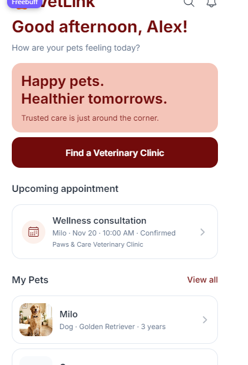
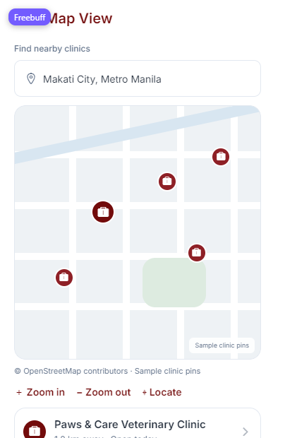
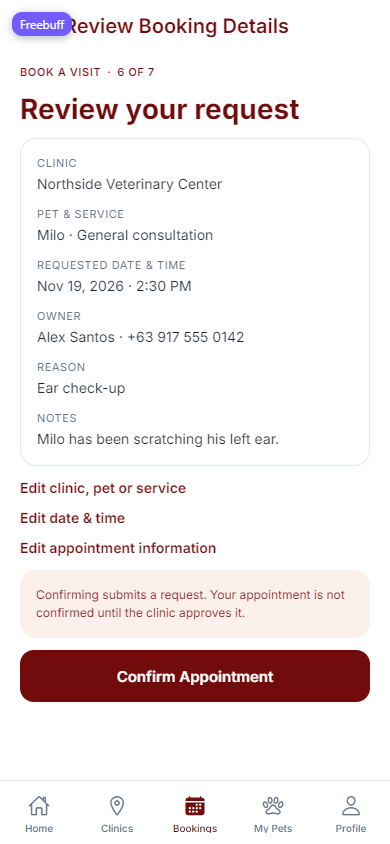
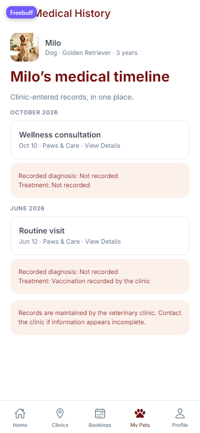
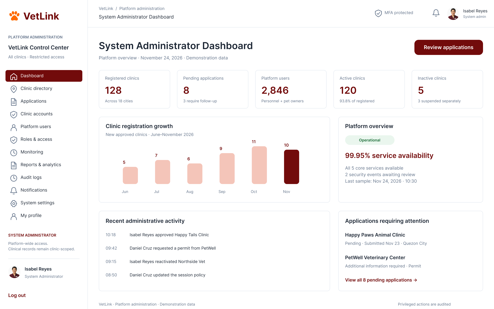
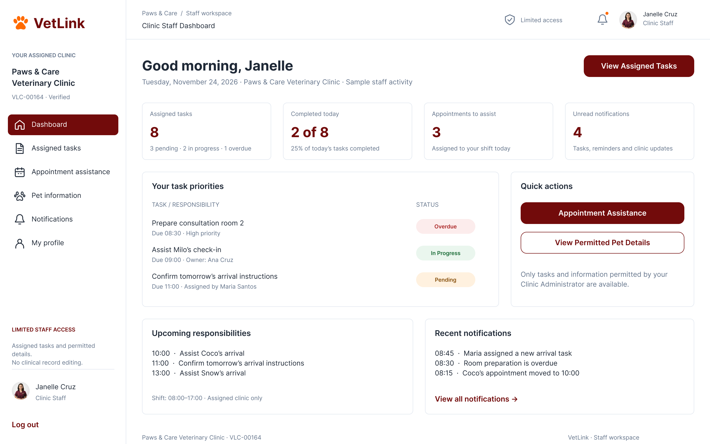

<div align="center">


# VetLink

**A veterinary clinic locator, appointment booking and pet health record system.**

A mobile app for pet owners and a web workspace for every role in a clinic, sharing one Supabase backend.


</div>

---

## Overview

Pet owners use VetLink to find nearby clinics, book and manage appointments, and keep their pets' medical and vaccination history in one place. Clinics use the web workspace to run the front desk, record consultations and vaccinations, assign staff tasks and manage their public profile. A platform administrator reviews clinic applications and oversees the whole network.

The whole system runs on one Supabase project. **Every permission is enforced by the database through Row Level Security**, not by hiding buttons. Each role reads only what its policies allow, and clinical records never leave the clinic that wrote them.

<p align="center">
  
  &nbsp;
  
  &nbsp;
  
  &nbsp;
  
</p>

## Features

### 📱 Pet owner mobile app (Expo / React Native)

- **Clinic locator**: search, filters, clinic details, services and contact details
- **Real map, free**: OpenStreetMap with a pin per clinic, **Locate me** (GPS) for true distances and nearest-first sorting, and **Get Directions** into Google Maps. No API key, no billing
- **Appointment booking**: choose the pet, service, date and time, review, then confirm
- **Appointment management**: status tracking, reschedule and cancel requests, history
- **Pet profiles** with photos, plus **medical records** and **vaccination records** with upcoming reminders
- **AI-assisted inquiry**: suggested questions, chat, and escalation to a clinic inquiry
- Notifications, account settings, password change, help and privacy
- Email/password and Google sign-in, email verification and password reset

### 🖥️ Clinic and platform web workspace (React + Vite)

Each role gets its own navigation (a slide-out ☰ menu on phones and tablets), routes and route guard. Clinics apply through a public **6-step registration** (`/register`) and place their location on a map picker with OpenStreetMap address search.

| Role | Screens | Highlights |
| --- | --- | --- |
| **System Administrator** | SA-01 – SA-16 | Clinic application review, clinic directory and suspension, platform users, roles, monitoring, reports, audit log, announcements, MFA-aware profile |
| **Clinic Administrator** | CA-01 – CA-14 | Clinic profile and photos, services, staff invitations and roles, permissions, reports, CSV import/export, team notifications, **staff task assignment** |
| **Appointment Manager** | AM-01 – AM-14 | Request queue, confirm/reject, schedule calendar, create/reschedule/cancel, register owners and pets, client inquiries, notifications |
| **Veterinarian** | VET-01 – VET-12 | Daily dashboard, assigned appointments, patient details, **consultation workspace** (findings, vitals, diagnosis, plan; signs the record and closes the visit), medical records with author-only edits, vaccinations, consultation history |
| **Clinic Staff** | CS-01 – CS-06 | Assigned tasks with progress updates, appointment assistance (record an arrival, notify reception), permitted pet information, notifications |

<p align="center">
  
  
</p>

### 🔐 Backend (Supabase)

- 25 ordered SQL migrations: schema, RLS policies, storage buckets and security-definer RPCs
- Role helpers (`is_clinic_veterinarian`, `is_clinic_receptionist`, …) shared by all policies
- Clinic Staff get **limited RPCs** that return only names, species and times, never owner contacts or clinical data
- Appointment status changes go through a trigger that only allows each role its own transitions
- Medical records and vaccinations can't be deleted, and records can only be amended by their author
- Edge Functions: `invite-staff`, `provision-clinic-admin`, `register-pet-owner`

## Tech stack

| Layer | Technology |
| --- | --- |
| Mobile | Expo 58, React Native 0.88, React Navigation 7, `expo-location`, `react-native-webview` |
| Web | React 19, React Router 7, Vite 7, hand-built design system matching Figma |
| Maps | Leaflet + OpenStreetMap tiles, Nominatim address search (free, no key) |
| Hosting | Vercel (web), Expo EAS (Android APK), Supabase (backend) |
| Backend | Supabase: Postgres, Auth, Storage, Row Level Security, Edge Functions (Deno) |
| Language | TypeScript throughout |
| Tests | `node:test` for app logic, PGlite (Postgres in WASM) for migrations and RLS |

## Project structure

```
VetLink/
├── App.tsx, index.ts        # Mobile app entry
├── src/                     # Pet owner mobile app
│   ├── screens/             #   auth, home, clinics, bookings, pets, profile, …
│   ├── navigation/          #   tab + stack navigators
│   ├── context/             #   auth, booking, pet and app state
│   ├── components/MapCanvas #   clinic map (WebView / iframe + Leaflet)
│   └── lib/                 #   Supabase client, distance + map helpers
├── eas.json                 # Expo EAS build profiles (Android APK)
├── web/                     # Clinic + platform web workspace
│   ├── vercel.json          #   Vercel build + page-refresh rewrite
│   └── src/
│       ├── screens/         #   sa/ ca/ am/ vet/ cs/ register/ shared/ auth/
│       ├── clinic/          #   data access + pure, tested list logic
│       ├── sa/              #   platform admin data + shared UI pieces
│       ├── layout/, shell/  #   app shell, sidebar navigation per role
│       └── styles/          #   design tokens and component CSS
└── supabase/
    ├── migrations/          # 0001 – 0025, applied in order
    ├── setup/               # paste-ready schema + demo seed for a new project
    ├── functions/           # Edge Functions
    ├── tests/               # PGlite migration + RLS test suite
    └── qa/                  # Live-project QA scripts
```

## Getting started

### Prerequisites

- Node.js 20+ and npm
- A Supabase project
- Optional: the [Supabase CLI](https://supabase.com/docs/guides/cli) and Expo Go on a phone

### 1. Set up the database

**Quickest way (new project):** open Supabase → **SQL Editor**, paste all of [`supabase/setup/01_schema.sql`](supabase/setup/01_schema.sql) and click **Run**. For a demo project, run [`supabase/setup/02_dev_seed.sql`](supabase/setup/02_dev_seed.sql) the same way. Both files are generated from the migrations by `node supabase/setup/build.mjs`.

Or apply the migrations in `supabase/migrations/` in order with the CLI:

```bash
supabase link --project-ref <your-project-ref>
supabase db push
```

You can also paste them into the Supabase SQL editor one at a time. Then deploy the Edge Functions:

```bash
supabase functions deploy invite-staff
supabase functions deploy provision-clinic-admin
supabase functions deploy register-pet-owner
```

For development only, `supabase/seed.dev.sql` adds sample clinics and `supabase/seed.dev.system-admin.sql` creates a System Administrator login. **Don't run either one on production.** See [`supabase/README.md`](supabase/README.md) for auth redirect URLs, storage and the other dashboard settings.

### 2. Run the mobile app

```bash
cp .env.example .env        # set EXPO_PUBLIC_SUPABASE_URL and EXPO_PUBLIC_SUPABASE_ANON_KEY
npm install
npm start                   # then press a (Android), i (iOS) or w (web)
```

### 3. Run the web workspace

```bash
cd web
cp .env.example .env        # set VITE_SUPABASE_URL and VITE_SUPABASE_ANON_KEY
npm install
npm run dev                 # http://localhost:5173
```

> Only the **anon** key belongs in either `.env`. The `service_role` key bypasses Row Level Security and must never go in client code.

## Creating accounts

No account can give itself a role. Each one is created by the account above it:

| Account | Who creates it | Where |
| --- | --- | --- |
| **System Administrator** | You, once, with SQL | Run `supabase/setup/02_dev_seed.sql`, or copy its admin block with your own email and password |
| **Clinic Administrator** | The clinic applies, and a System Administrator approves | The clinic signs up at **`/register`** (6-step application). The System Admin then opens **Applications → Review → Approve** |
| **Appointment Manager / Veterinarian / Clinic Staff** | The Clinic Administrator | **Staff management → Invite staff**. New people get an invitation email that opens `/activate` |
| **Pet owner** | Themselves, in the mobile app, or the front desk | Mobile sign-up, or **Pet owners → Register owner** in the front desk workspace |

Invitation and approval emails are sent by the Edge Functions, so deploy them and add `<your-site>/activate` and `<your-site>/register/apply` to Supabase → Authentication → URL Configuration.

## Testing

```bash
# Mobile: distance and map helpers
npm test

# Web: list, filter, scheduling, form and address-search logic
cd web && npm test

# Database: replays every migration on a throwaway Postgres and checks the RLS rules
cd supabase/tests && npm install && npm test

# Type checks
npx tsc --noEmit            # mobile app (repo root)
cd web && npm run build     # web typecheck + production build
```

The database suite needs no Docker. It runs Postgres in WebAssembly via PGlite, and it fails if a migration on disk is missing from the run.

## Security model in brief

- **Clinic scope**: staff read only the clinic they hold an active membership in.
- **Veterinarians** read their clinic's medical records but write records only under their own name. They can only complete visits assigned to them.
- **Appointment Managers** run the schedule but can't read clinical records.
- **Clinic Staff** see today's times, pet names and species through limited RPCs, and can only update their own tasks.
- **System Administrators** manage the platform. Clinical records stay clinic-scoped even for them.
- Roles are written only by the service role and membership triggers. A browser session can't promote itself.

## Deployment

Everything runs on free plans:

1. **Supabase**: create a project, paste `supabase/setup/01_schema.sql` into the SQL Editor, deploy the three Edge Functions, and set `CONSOLE_ORIGIN` to your website address (`npx supabase secrets set CONSOLE_ORIGIN=https://your-site.vercel.app`).
2. **Website on Vercel**: import the repository, set **Root Directory** to `web`, and add `VITE_SUPABASE_URL` and `VITE_SUPABASE_ANON_KEY`. `web/vercel.json` handles the build and page refreshes.
3. **Android app with Expo EAS**: `eas init`, store `EXPO_PUBLIC_SUPABASE_URL` and `EXPO_PUBLIC_SUPABASE_ANON_KEY` with `eas env:create`, then `eas build -p android --profile preview` for an installable APK.
4. **Auth redirects**: add `<site>/activate`, `<site>/reset-password`, `<site>/register/apply`, `vetlink://auth-callback` and `vetlink://reset-password` under Supabase → Authentication → URL Configuration.

The map tiles and address search use OpenStreetMap's free services under their fair-use policies. For heavy traffic, switch the tile URL in `src/lib/leafletHtml.ts` and `web/src/ui/LocationPicker.tsx` to a provider such as MapTiler (free key).

## Design

The UI follows the VetLink Figma file: burgundy, peach and orange accents on white, Inter type, 1440 × 900 desktop frames and mobile frames for the owner app. Screen codes such as `VET-04` or `CS-02` in the source match the Figma frame names.

## Roadmap

- Professional credentials on the veterinarian profile (specialization, PRC license). This needs new profile columns.
- Persisting clinic-staff arrival check-ins in the database. Today an arrival is sent to reception as a notification.
- Email and push delivery for console notifications
- Code-splitting the web bundle

## License

No license has been chosen yet. Add one before publishing if others will use or contribute to the code.
